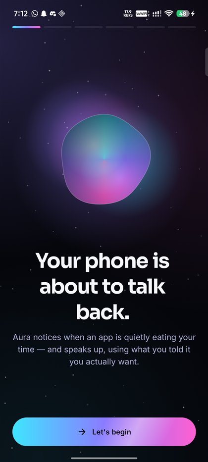
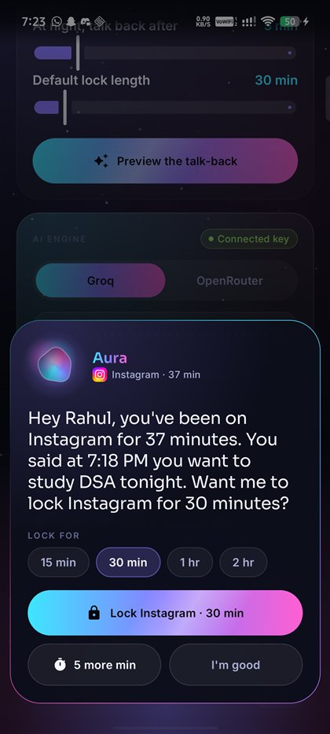
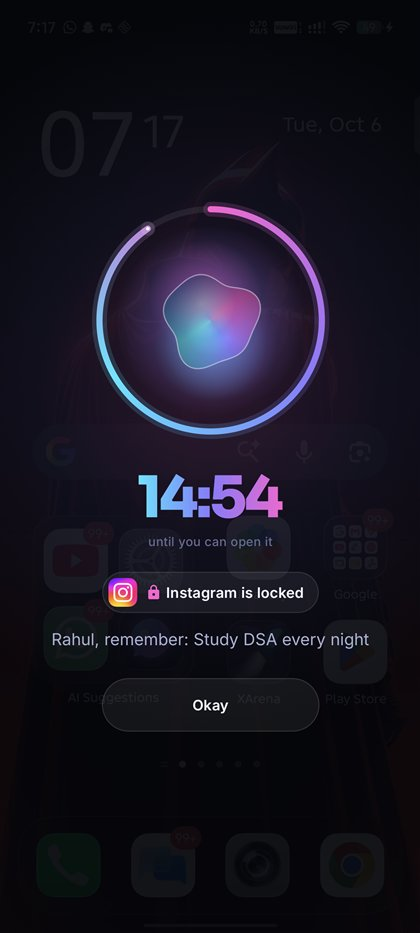
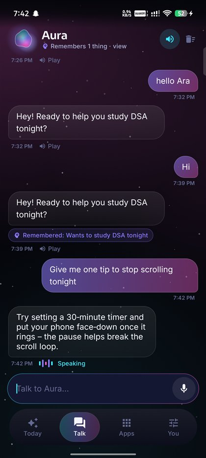
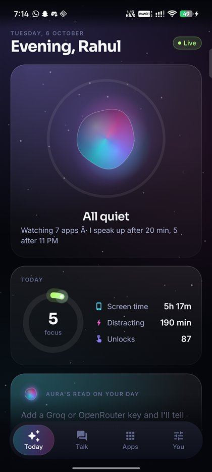
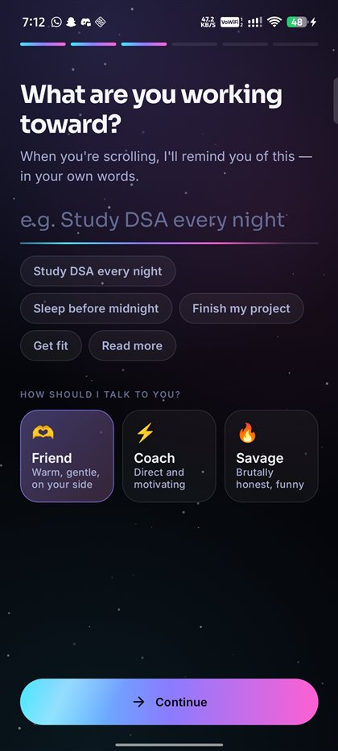
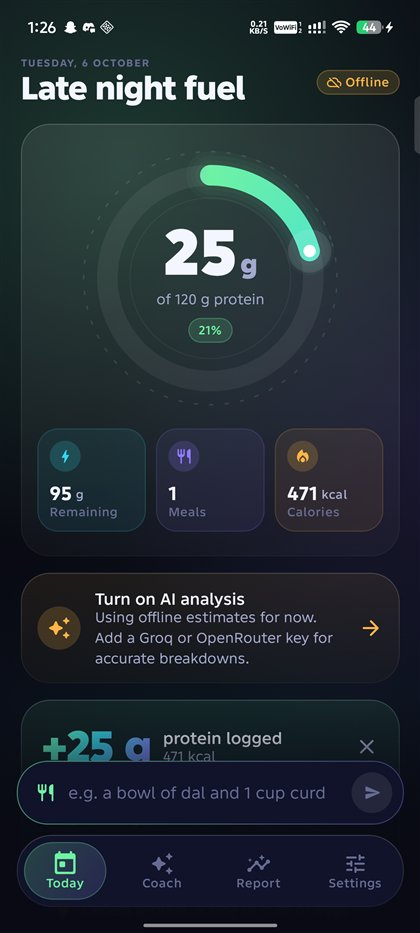
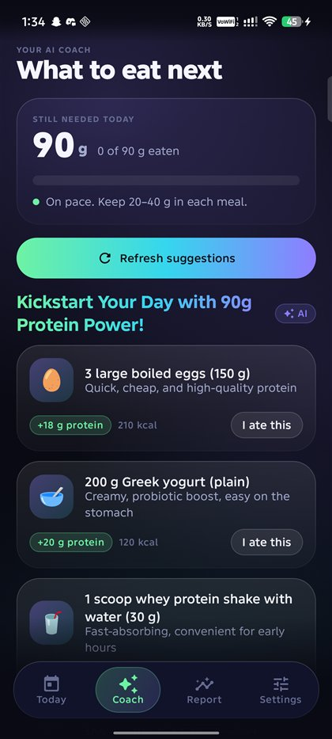
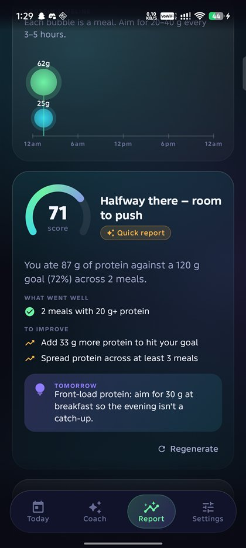
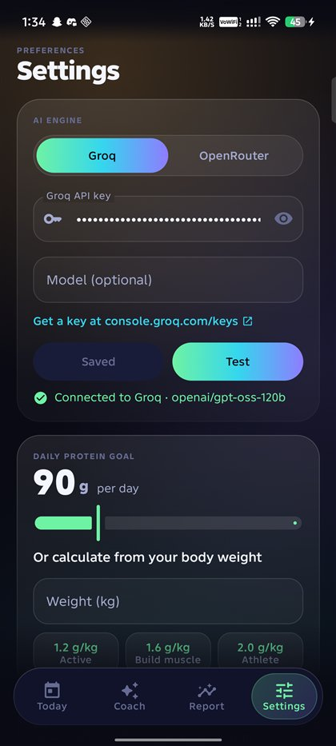

<div align="center">

# 📱 Android Apps

**Two AI-powered Android apps built with Kotlin & Jetpack Compose —
cinematic motion, premium dark design, and real on-device intelligence.**


[🧠 Aura](#-aura--the-phone-that-talks-back) · [💪 Protein Pulse](#-protein-pulse--ai-protein-tracker) · [🛠 Build & run](#-build--run) · [🔑 AI keys](#-ai-keys)

</div>

---

## 🧠 Aura — the phone that talks back

> *"Rahul, you've been on Instagram for 37 minutes. You told me yesterday you wanted to study DSA. Want me to lock it for 30 minutes?"*

Aura notices when an app is quietly eating your time — and **speaks up, out loud**, over whatever you're doing, using the goals you told it about. Ask it to lock an app and it keeps its word.

<p align="center">
  
  
  
  
</p>
<p align="center">
  
  
</p>

**What it does**

| | |
|---|---|
| 👀 **Watches** | An Accessibility Service sees *which app* is in front (never the screen), times each session, and tracks screen time & unlocks via Usage Stats. A Notification Listener counts how often apps ping you. |
| 🗣️ **Talks back** | Past your limit (20 min, or 5 after 11 PM) a talk-back card slides over the app. The AI writes a personal message — your name, the exact minutes, what you promised and *when* — and reads it aloud, ducking the reel's audio while it speaks. |
| 🔒 **Locks** | Lock for 15 min – 2 hr. Opening a locked app sends you home and shows a live countdown with your goal. |
| 💬 **AI agent** | Chat (or speak) with Aura. It remembers your goals with dates, answers from your real usage, and can lock / unlock / watch apps on request. Replies are spoken with live sound bars. |
| 🎭 **Personality** | Friend, Coach or Savage tone. |
| 📊 **Today** | Focus score, hour-by-hour rhythm chart (late-night hours glow), top apps, talk-back history and an AI read on your day. |

**Design & motion** — a living liquid orb (sine-wave morphing sphere with orbiting lights, breathing, thinking and speaking states), drifting aurora background, word-by-word AI text reveal, rotating aurora borders, a liquid nav-bar indicator that stretches between tabs, odometer numbers, haptics everywhere. All per-frame animation runs in the draw phase (no recomposition), the app requests the panel's highest refresh rate, and release builds are R8-optimised and AOT-compiled — **0 janky frames** measured on device.

📂 Source: [`Aura/`](Aura)

---

## 💪 Protein Pulse — AI protein tracker

Type what you ate — *"3 eggs and 2 rotis"* — and AI breaks it into foods with protein and calories. Get smart suggestions for what to eat next and an end-of-day report.

<p align="center">
  
  
  
  
</p>

| | |
|---|---|
| 🍳 **Natural-language logging** | AI splits meals into items with protein & kcal. Works offline too with a built-in estimator for ~50 common (incl. Indian) foods. |
| 🎯 **Animated goal ring** | Glowing gradient ring with comet tip, rolling-digit counter, confetti when you hit your goal. |
| 🤖 **AI coach** | Suggestions that fit your remaining protein, time of day and diet (veg / egg / non-veg / vegan) — log any with one tap. |
| 📈 **Daily report** | Score gauge, wins, improvements, tomorrow's plan, protein timeline and a 7-day chart with streaks. |
| 🔔 **Evening notification** | Daily summary at your chosen time. |

📂 Source: [`ProteinPulse/`](ProteinPulse)

---

## 🛠 Build & run

**Requirements:** Android Studio (2025.3+), JDK 17+ (Android Studio's bundled JBR works), Android SDK 36.

```bash
git clone https://github.com/Rahul9994/Android-apps.git
```

1. In Android Studio choose **File → Open** and pick `Aura` or `ProteinPulse` (each is its own Gradle project).
2. Let Gradle sync, connect a phone (USB debugging on) and press **Run ▶**.

Or from a terminal inside an app folder:

```bash
./gradlew installRelease
```

> 💡 Use the **release** build for the smoothest animations. It's signed with the debug key for easy sideloading — swap in your own signing config before publishing.

**Aura permissions** (granted during onboarding): Usage access, Accessibility (*if Android says "Restricted setting": App info → ⋮ → Allow restricted settings*), and optionally Notification access & Notifications.

---

## 🔑 AI keys

Both apps work with **[Groq](https://console.groq.com/keys)** (fast, free tier) or **[OpenRouter](https://openrouter.ai/keys)**. Paste your key in the app's settings — it's stored **only on your phone**, never in this repo.

Model selection is **Auto** by default: the app picks the strongest model your key can use (e.g. `openai/gpt-oss-120b` on Groq) and automatically switches if a provider retires a model. Aura also lets you pick any model from a searchable list.

---

## 🧱 Tech stack

`Kotlin 2.2` · `Jetpack Compose (BOM 2025.08)` · `Material 3` · `Coroutines & Flow` · `DataStore` · `SQLite` · `OkHttp` · `WorkManager` · `AccessibilityService` · `UsageStatsManager` · `NotificationListenerService` · `TextToSpeech` · `Groq / OpenRouter (OpenAI-compatible API)`

<div align="center">

---

Made with ☕ and Compose by **[Rahul9994](https://github.com/Rahul9994)**

</div>
